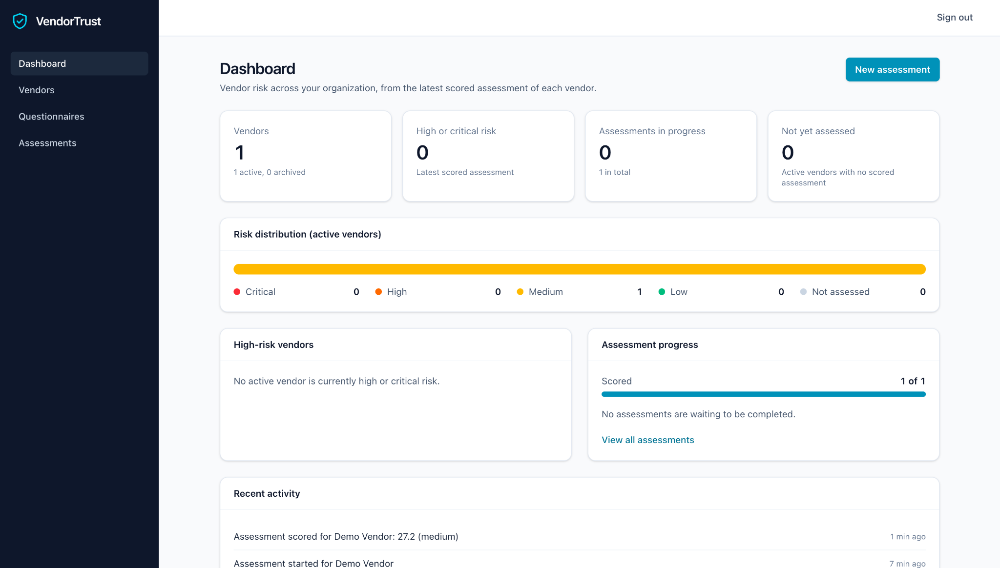
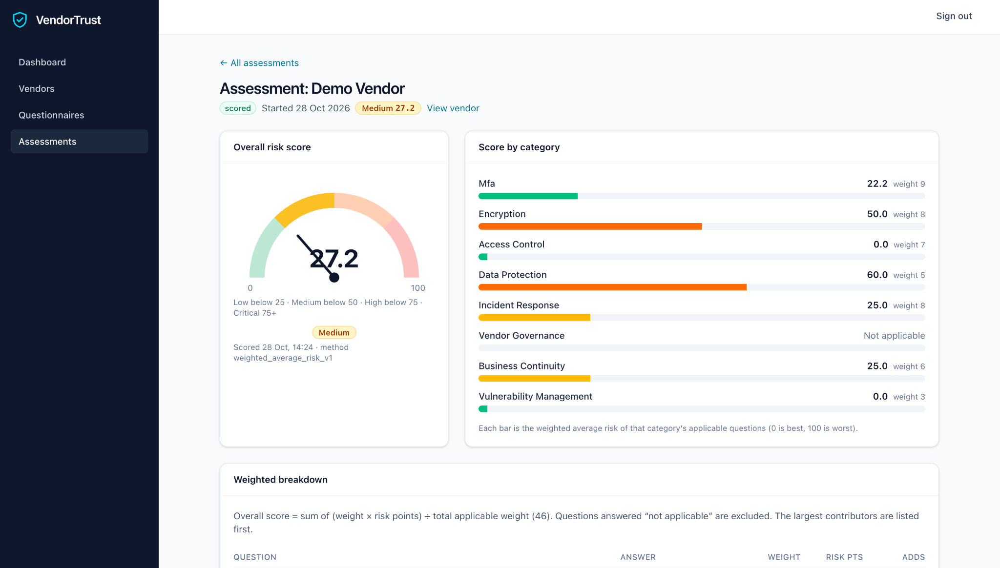
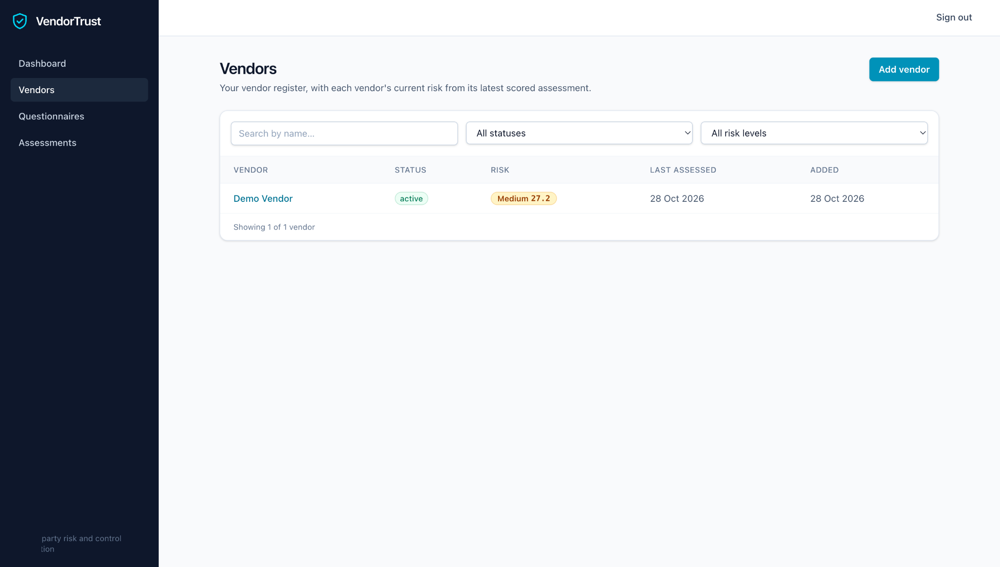
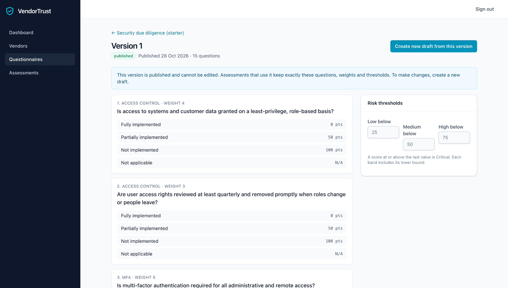
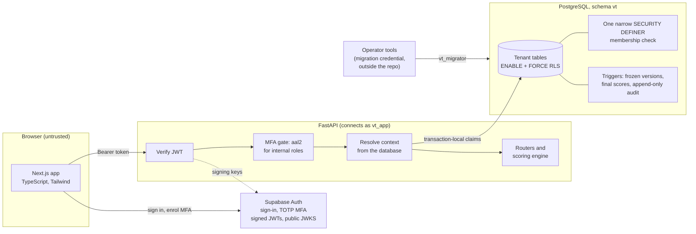

# VendorTrust

**Third-party security due diligence, built security-first.** VendorTrust is a full-stack GRC (governance,
risk and compliance) platform that lets an organization register its vendors, assess them with
configurable security questionnaires, and turn the answers into an explainable, deterministic risk score,
on a multi-tenant foundation where the **database itself enforces who can see what**.

It is a portfolio project: a working vertical slice with the security model taken seriously, an honest
account of what is not built yet, and the tests to back every claim.

[](https://github.com/Janet-Njoku/VendorTrust/actions/workflows/ci-api.yml)
[](https://github.com/Janet-Njoku/VendorTrust/actions/workflows/ci-web.yml)
[](https://github.com/Janet-Njoku/VendorTrust/actions/workflows/security.yml)

**In 30 seconds**

- **What:** multi-tenant vendor risk management: vendor register, versioned questionnaires, assessments,
  deterministic explainable scoring, dashboard and audit trail.
- **Security engineering:** tenant isolation enforced by PostgreSQL row level security (`FORCE`, least-privilege
  roles, one narrow `SECURITY DEFINER` function), JWT/JWKS verification, MFA (`aal2`) for internal roles,
  roles and scope taken from the database, an append-only audit log, a one-time database-enforced bootstrap.
- **Evidence:** over 1,200 automated tests, including cross-tenant and forged-claim attacks against a real
  PostgreSQL, plus CI with gitleaks, dependency audits and pinned, read-only workflows.
- **Honest limits:** [threat model](docs/threat-model.md) with residual risks; no CSP, rate limiting or audit hash
  chain yet; not deployed.

> **Status:** a working MVP. Verified by the author locally and against a real Supabase project (PostgreSQL and
> Auth): administrator onboarding, MFA, vendor creation and questionnaire publishing. Not deployed; the full
> assessment flow has not been validated against Supabase yet. See
> [What is and is not built](#what-is-and-is-not-built).

## The problem

Companies depend on dozens of vendors that touch their data, and "vendor risk management" often means
spreadsheets: questionnaires emailed around, scores that depend on who filled them in, no history of what
was asked when, and tenant or role mistakes that nobody notices until they matter. VendorTrust shows the
alternative: structured questionnaires, scoring rules anyone can read and reproduce, frozen history, an
audit trail, and isolation between organizations that does not depend on every query being written
correctly.

## What it does

| Workflow | What you can do today |
|---|---|
| **Vendor register** | Add, edit, search, filter and archive vendors; each shows its current risk from its latest scored assessment |
| **Questionnaires** | Build any number of templates, or copy the built-in 15-question starter (access control, MFA, encryption, vulnerability management, incident response, business continuity, data protection, vendor governance); edit questions, answer options, weights and risk thresholds; reorder, archive, publish |
| **Versioned history** | Publishing freezes a version. Changes go into a new draft, so an assessment already started never changes, even if the template is edited later |
| **Assessments** | Start one for a vendor, answer question by question (saved as you go), finalize and score |
| **Risk scoring** | Weighted average of answer risk points, 0 to 100, classified Low, Medium, High or Critical, with a category breakdown and the contribution of every question ([methodology](docs/scoring.md)) |
| **Dashboard** | Vendor totals, risk distribution, high-risk vendors, assessment progress, recent activity |
| **Audit trail** | Every create, change, response and scoring decision is recorded with the acting user and role |
| **Access** | Email sign-in with TOTP multi-factor authentication for internal roles; roles `org_admin`, `analyst`, `reviewer`, `auditor`, `vendor_user`; a one-time operator bootstrap for the first organization |

## Screenshots

Captured from the running application with a single sample vendor ("Demo Vendor"). Click an image for full size.

**Dashboard.** Portfolio view built from each vendor's latest scored assessment: vendor totals, risk
distribution, high-risk vendors, assessment progress, and recent activity taken from the audit trail.



**Assessment results.** A scored assessment: an overall 0 to 100 risk score on a gauge with the Low, Medium, High
and Critical thresholds, a per-category breakdown with each category's weight, "not applicable" categories left
out, and the scoring method (`weighted_average_risk_v1`) recorded on the result.



**Vendor register.** Searchable and filterable by status and risk level, with each vendor's current risk taken
from its latest scored assessment.



**Published questionnaire.** A published version is read-only: assessments that use it keep exactly these
questions, weights, answer risk points and thresholds. Changes go into a new draft.



The MFA setup screens are not captured yet. A reviewer walkthrough is in
[docs/portfolio-demo.md](docs/portfolio-demo.md), and the capture notes are in
[docs/screenshots/](docs/screenshots/README.md).

## Architecture



A longer walkthrough (request sequence, state machines, data model) is in
[docs/architecture.md](docs/architecture.md); the security view on one page is
[docs/security-architecture.md](docs/security-architecture.md).

### How a request is secured

1. **Authenticate:** the bearer token's signature, issuer, audience, expiry and algorithm (ES256 or RS256 only)
   are verified against the identity provider's public keys.
2. **MFA:** internal roles need an `aal2` token; anything else is treated as `aal1` and refused.
3. **Resolve scope from the database:** `vt.begin_request` reads the caller's **own** membership row and derives
   organization, role and vendor from it. Nothing from the request or token claims is trusted for scope.
4. **Isolate in PostgreSQL:** every policy requires a live membership, so the application role sees only its
   own tenant's rows even if a query is wrong.
5. **Assess and score:** published questionnaire versions are frozen by triggers; scoring is deterministic
   (`weighted_average_risk_v1`, 0 to 100, thresholds 25/50/75 stored per version), so a result can be
   reproduced from its answers ([scoring](docs/scoring.md)).
6. **Record:** the application role can only append to the audit log.

## Security design

The interesting part of the project. Each row is enforced in code and covered by tests:

| Threat | Control |
|---|---|
| One tenant reading or changing another's data | PostgreSQL row level security with `FORCE`, on every table; the API connects as a role that owns nothing and cannot bypass it; queries carry **no** organization filter, so a query bug cannot leak |
| Trusting the client for role or organization | Both come from the user's own membership row in the database; token claims such as `role` are ignored; only the signed `sub`, `email` and `aal` are used |
| Forged or confused tokens | Signature, issuer, audience and expiry checked against the public JWKS; asymmetric algorithms only; `alg: none` and algorithm-confusion tokens rejected |
| Account takeover of privileged users | Internal roles need an `aal2` (MFA) token on every data route; this cannot be disabled in production |
| Open registration granting access | Signing in provisions a user row and nothing else. Access needs a membership; the first organization is created by an operator command that the **database** permits exactly once |
| Rewriting history | Published questionnaire versions are immutable and scored assessments final, by database triggers; the audit log is append-only for the application role |
| Leaked credentials | Database credentials live outside the repo, in files the loader refuses unless owner-only; never printed; the web config refuses a secret or service-role key |
| A privileged helper function being abused | Exactly one `SECURITY DEFINER` function, owned by a non-superuser role with no `BYPASSRLS`, pinned `search_path`, no arguments, no dynamic SQL, execute rights revoked from `PUBLIC` |
| A migration run by mistake | Alembic and the bootstrap are dry runs unless explicitly committed; downgrades need an explicit flag; only the plain migration role may run them |

**Limits, stated plainly** ([trust-boundary.md](docs/trust-boundary.md)): the database cannot verify a
JWT, so the context it receives is a claim made by the API; RLS protects against bugs, guessed
identifiers and confused-deputy mistakes, **not** against an attacker who holds the application's database
credential and knows a user id. The audit log is append-only for the application role but not immutable
against a database owner or superuser. During development the author also tested the checks by hand: the security SQL, API logic and
frontend were deliberately broken in a number of ways to confirm that the tests noticed, and tests were
added or tightened where they did not. This was a manual exercise, not an automated mutation-testing suite,
and it is not reproducible from this repository.

## Technology

| Layer | Stack |
|---|---|
| Web | Next.js 16, React 19, TypeScript, Tailwind CSS 4, Vitest and Testing Library |
| API | Python 3.12, FastAPI, Pydantic v2, SQLAlchemy 2, Alembic, PyJWT, psycopg 3 |
| Data | PostgreSQL 17 (Supabase-compatible), row level security |
| Identity | Supabase Auth (JWT, JWKS, TOTP MFA); a loopback-only stand-in for local development |
| Tooling | uv, ruff, mypy (strict), pytest, pnpm, ESLint, GitHub Actions (with a PostgreSQL service), gitleaks, pip-audit and `pnpm audit` |

## Try it

**1. See the interface (no backend, no account).** Demo mode serves fictional data held in your browser,
with a banner on every screen, and never contacts a server:

```bash
pnpm install
NEXT_PUBLIC_DEMO_MODE=true pnpm web:dev          # http://localhost:3000 , then "Enter the demo"
```

**2. Run the real stack locally** (real API, real PostgreSQL, real migrations, the real operator bootstrap
and MFA, with only the identity provider stood in locally): follow
[docs/local-e2e.md](docs/local-e2e.md). It uses no Supabase project and no real credentials.

Prerequisites: [uv](https://docs.astral.sh/uv/), Node 24 (`.node-version`) with pnpm 12, and for the
database tests PostgreSQL 17 (`brew install uv pnpm postgresql@17`).

## Tests

```bash
# API (apps/api). The database tests use the local cluster: scripts/dev-db.sh init   (once)
uv run ruff check . && uv run ruff format --check . && uv run mypy && uv run pytest

# Web (from the repository root)
pnpm web:lint && pnpm web:typecheck && pnpm web:test && pnpm web:build
```

Over 1,200 automated tests (1,026 backend collected by pytest, 195 frontend in Vitest) cover scoring maths, every endpoint across
tenants and roles against a real PostgreSQL, authentication and MFA, migrations, the bootstrap, the
credential tooling, a full register-to-scored-assessment journey, and the interface. Database tests skip
locally when no server is running but **fail** in CI, so the security suite cannot silently not run
(`CI=true` or `VT_TEST_REQUIRE_DB=1`).

## What is and is not built

**Built and tested:** everything in the table above, the security controls, the migrations (0001 to 0006),
the local end-to-end workflow, and CI.

**Not built (limitations and future work):**

- **Not deployed.** The automated tests run against a local PostgreSQL with a local identity stand-in. The
  author has also exercised a real Supabase project by hand (administrator onboarding, MFA, vendor creation,
  questionnaire publishing); the full assessment flow has not been validated there yet, and nothing has been
  tested under production conditions ([RUNBOOK](infra/db/RUNBOOK.md)).
- **No membership management or invitations.** An administrator grants roles directly in the database; no
  vendor portal for vendors to answer their own questionnaires.
- **Scoring is simpler than the design baseline.** Self-reported answers are weighted and averaged; there is
  no inherent-risk tiering, evidence upload and validation (ClamAV scanning is only scaffolding), reviewer
  control verification, residual risk, findings, remediation, risk acceptance, approvals or PDF reports.
  [risk-methodology.md](docs/risk-methodology.md) describes that direction and is marked as not implemented.
- **Security gaps to close before real use:** no Content Security Policy, no rate limiting, no TOTP recovery
  codes, no audit hash chain, no data-retention controls. [security-controls.md](docs/security-controls.md)
  lists each control with its honest status.
- **The credential-guard hook for Claude Code** (`.claude/hooks/`) is a best-effort tripwire with
  regression tests, not a sandbox. It is inactive until registered in your own, git-ignored
  `.claude/settings.local.json`; see [CLAUDE.md](CLAUDE.md#claude-code-setup-nothing-here-is-active-until-you-register-it-locally).
- **No license has been chosen yet.**

## Repository map

```
apps/api/     FastAPI service, Alembic migrations, scripts (bootstrap, local identity stand-in), tests
apps/web/     Next.js app: screens, typed API client, auth and MFA, demo mode, tests
infra/db/     Role and schema bootstrap SQL, preflight and verification, runbook for a Supabase project
scripts/      Local PostgreSQL and end-to-end helpers
docs/         Architecture, API, scoring, trust boundary, frontend, local end-to-end guide
.claude/      Credential-guard hook and its tests (settings stay local)
.github/      CI for the API (with PostgreSQL) and web app, security scanning
```

## Documentation

| Document | Contents |
|---|---|
| [docs/architecture.md](docs/architecture.md) | Components, diagrams, decisions, data model, what is designed but not built |
| [docs/security-architecture.md](docs/security-architecture.md) | The security design on one page: request path, roles, secrets, pipeline |
| [docs/threat-model.md](docs/threat-model.md) | Threats, implemented mitigations with test references, residual risks |
| [docs/portfolio-demo.md](docs/portfolio-demo.md) | A 5 to 15 minute reviewer route and the screenshot checklist |
| [docs/trust-boundary.md](docs/trust-boundary.md) | The security model, trust boundary, limits and the test map |
| [docs/scoring.md](docs/scoring.md) | Questionnaire versioning and the scoring methodology with a worked example |
| [docs/api.md](docs/api.md) | Endpoints, roles, errors, MFA, first-login provisioning |
| [docs/frontend.md](docs/frontend.md) | Screens, access states and MFA, auth and secrets, demo mode |
| [docs/local-e2e.md](docs/local-e2e.md) | Run the real stack locally, step by step |
| [docs/security-controls.md](docs/security-controls.md) | Control requirements with implementation status |
| [docs/risk-methodology.md](docs/risk-methodology.md) | The fuller risk and evidence design (not implemented) |
| [docs/roadmap.md](docs/roadmap.md) | Where the project stands and the phase plan |
| [docs/phase1-design.md](docs/phase1-design.md) | The approved Phase 1 security decisions and step status |
| [infra/db/RUNBOOK.md](infra/db/RUNBOOK.md) | Beginner-friendly procedure for a Supabase project (roles, credentials, first organization) |
| [infra/db/README.md](infra/db/README.md) | Bootstrap design, safeguards and verification |
| [docs/dependency-notes.md](docs/dependency-notes.md) | Rationale for non-obvious dependencies |
| [docs/screenshots/](docs/screenshots/README.md) | Screenshot list and capture notes |

## Roadmap

Planned, not built ([roadmap.md](docs/roadmap.md) has the phase plan): membership management and vendor
invitations, a Content Security Policy and rate limiting, evidence upload with malware scanning, reviewer
verification and findings/remediation, and a hash-chained audit log. Each is listed with its status in
[security-controls.md](docs/security-controls.md).

## Security engineering demonstrated

| Skill | Where to see it |
|---|---|
| Multi-tenant isolation design | RLS with `FORCE`, no application-side tenant filter: [trust-boundary.md](docs/trust-boundary.md), `tests/db/test_rls_isolation.py` |
| Least-privilege database design | Separate `vt_app` and `vt_migrator` roles, exact grants pinned by `tests/db/test_schema_guard.py` |
| Safe use of a privileged primitive | One `SECURITY DEFINER` function, with the recursion and ordering arguments tested |
| Authentication and authorization | JWT/JWKS verification, `aal2` MFA gate, DB-derived scope: `apps/api/app/auth.py`, `app/deps.py` |
| Abuse-case and negative testing | Forged claims, wrong algorithms, cross-tenant access, concurrent bootstrap, pooled-connection leaks |
| Secrets management | Credentials outside the repo, strict loader, redacted errors, gitleaks allowlist limited to one exact value |
| Secure delivery | Pinned, read-only GitHub Actions; dependency audits; database tests that fail rather than skip in CI |
| Threat modelling and honest reporting | [threat-model.md](docs/threat-model.md) with residual risks; limits stated beside every control |

## Security notes for contributors

- To report a suspected vulnerability, see [SECURITY.md](SECURITY.md).
- Never commit `.env` files, credential files or keys; the ignore rules cover them and CI scans for
  secrets. Database credentials live outside the repository (see the RUNBOOK).
- Mapping controls to ISO/IEC 27001:2022, SOC 2 or NIST CSF 2.0 (a design goal, not built) is for reference
  only and would not imply certification or compliance.
- pnpm dependency install scripts are denied by default (`pnpm-workspace.yaml`).
