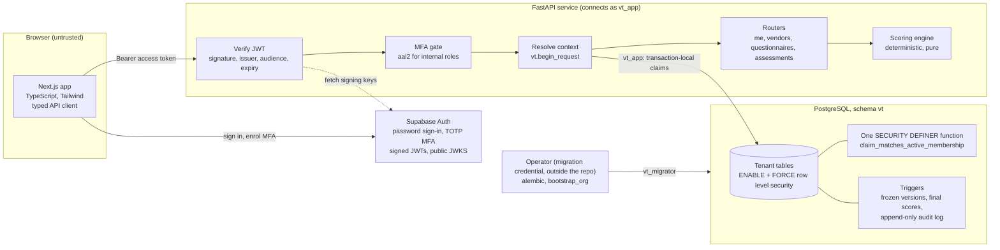
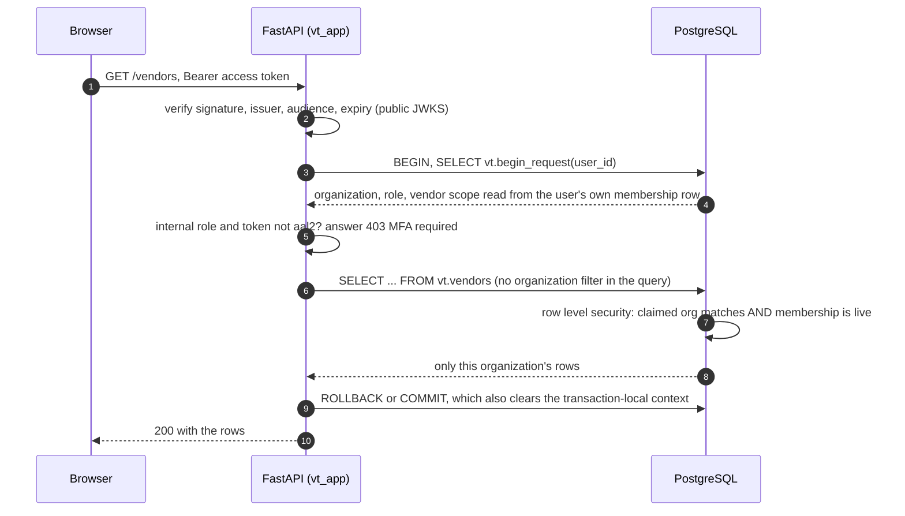
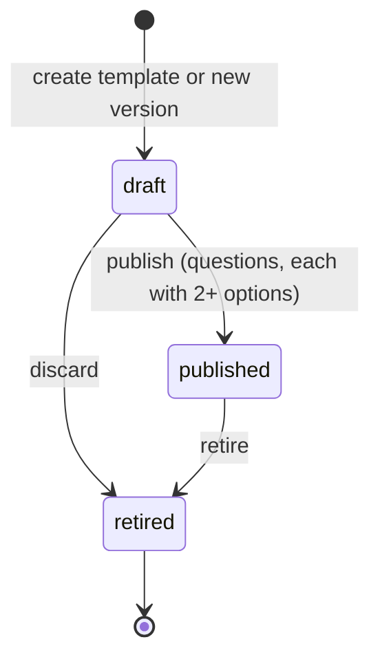
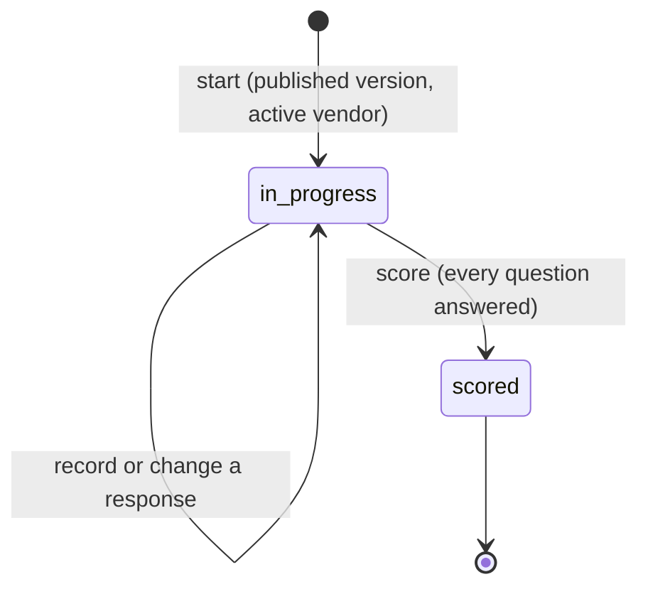

# VendorTrust Architecture

This document separates **what is built and tested** (sections 1 to 7) from **what is designed but not
built** (section 8). The roadmap in [roadmap.md](roadmap.md) says which is which phase by phase. For the
security view see [security-architecture.md](security-architecture.md) and [threat-model.md](threat-model.md).

## 1. Goals and scope

VendorTrust automates third-party security due diligence. The implemented MVP covers a vendor register,
configurable and versioned security questionnaires, assessments with deterministic risk scoring, an audit
trail, and the multi-tenant security model underneath. It demonstrates GRC automation, not formal
certification: mapping a control to ISO/IEC 27001:2022, SOC 2 or NIST CSF 2.0 would never imply compliance
or certification (see [section 8](#8-designed-but-not-built)).

## 2. System overview



| Component | Responsibility |
|---|---|
| `apps/web` | The user interface. Never decides risk or access; shows what the API returns. |
| `apps/api` | Authentication, MFA enforcement, workflow rules, scoring, audit. |
| PostgreSQL schema `vt` | System of record and the **enforcement point** for tenant isolation (row level security). |
| Supabase Auth | Identity: sign-in, MFA, token signing. VendorTrust never stores passwords. |
| Operator tools | Migrations and the one-time first-organization bootstrap, with a credential the API never holds. |

## 3. How one request is authorized



The query itself carries **no organization filter**: isolation comes from the database, so a bug in an
endpoint cannot leak another tenant's data. The context values are *claims made by the API*, not an
identity the database can verify; the limits of that are written down in
[trust-boundary.md](trust-boundary.md).

## 4. Key decisions

1. **FastAPI owns business logic.** Scoring and workflow are testable with pytest and no UI.
2. **Roles come from the database, never from the client.** Organization, role and vendor scope are read
   from the user's own `memberships` row; JWT claims such as `role` or `app_metadata`, and anything in a
   request body, are ignored. The only token claims used are `sub`, `email` and `aal`, all signed.
3. **Row level security is enforced and also a backstop.** The API connects as the least-privilege role
   `vt_app` (no `BYPASSRLS`, owns nothing). Policies read transaction-local `vt.claim_*` settings, set only
   by `vt.begin_request` from the verified token and the user's membership; tables use `FORCE ROW LEVEL
   SECURITY`; a single narrowly scoped `SECURITY DEFINER` function validates a membership without
   recursion and without relying on policy order or function cost. What this does and does not protect
   against: [trust-boundary.md](trust-boundary.md).
4. **Questionnaires are data, and history is immutable.** Templates have versions; publishing freezes a
   version (questions, options, weights, risk thresholds) through database triggers, and an assessment is
   bound to one published version. Editing a questionnaire never changes an assessment already started
   ([scoring.md](scoring.md)).
5. **No access without a grant.** Registering and signing in create a user row at most. Organization access
   comes from a membership an administrator gives, or from the one-time operator bootstrap (migration 0006:
   the database itself closes that window after the first run).
6. **MFA for internal roles.** The API requires the signed `aal2` claim for `org_admin`, `analyst`,
   `reviewer` and `auditor`; it cannot be disabled in production.
7. **Typed contract.** The web app talks to the API only through one hand-written, typed client
   (`apps/web/src/lib/api`) whose every endpoint is covered by a contract test. (Generating it from the
   OpenAPI schema is a possible improvement.)
8. **Credentials stay outside the repository.** Database URLs are loaded on demand from the environment or
   files in `~/.config/vendortrust/`, validated for ownership and mode, never printed.

## 5. Repository layout

```
apps/api/            FastAPI service
  app/               auth, deps, routers, scoring, db (models, context, session), bootstrap, credentials
  alembic/versions/  0001 to 0006: tables, request context, RLS and grants, questionnaires, bootstrap
  scripts/           bootstrap_org, dev_auth (local identity stand-in), connectivity checks
  tests/             unit, API, row-level-security, migration, end-to-end and credential-guard tests
apps/web/            Next.js app (src/app routes, src/components, src/lib: api client, auth, demo mode)
infra/db/            bootstrap.sql, preflight, verification, RUNBOOK for the Supabase project
scripts/             dev-db.sh (local PostgreSQL), dev-e2e.sh (local end-to-end helper)
docs/                this document, API, scoring, trust boundary, frontend, local end-to-end guide
.claude/hooks/       credential-guard hook for Claude Code (a tripwire, with regression tests)
.github/workflows/   CI for the API (with a PostgreSQL service), the web app, and security scanning
```

## 6. Implemented workflow

Questionnaire versions:



Only a `draft` can be edited; a new draft is cloned from the latest published version; at most one draft
exists per template. Assessments:



A `scored` assessment is final: it stores the score, risk level and a breakdown that re-derives it, and
the scoring decision is written to the audit log.

## 7. Data model (implemented)

`organizations`, `app_users` (id is the Supabase `sub`), `memberships` (role, optional vendor scope),
`vendors`, `questionnaire_templates`, `questionnaire_versions`, `questions`, `question_options`,
`assessments`, `assessment_responses`, `audit_log` (append-only for the application role). Every tenant table
carries `org_id`; composite foreign keys `(org_id, ...)` keep each row inside one organization and, for
assessments, one frozen questionnaire version. All have `ENABLE` and `FORCE ROW LEVEL SECURITY`, explicit
column-level grants for `vt_app`, and no `DELETE` anywhere (rows are archived, versions retired).

## 8. Designed but not built

The earlier design baseline is kept because it is the direction of the project, but **none of this exists
yet**: the tiered inherent-risk model, the three-stage evidence pipeline (upload, ClamAV quarantine,
validation, reviewer verification), control-specific residual risk, findings and remediation, risk
acceptance, approvals and a vendor portal ([risk-methodology.md](risk-methodology.md)), mapping a custom
control library to ISO/IEC 27001:2022, SOC 2 and NIST CSF 2.0 for reference only, audit-ready PDF reports,
a durable job queue, and an audit hash chain. The planned workflow was:

| State | Entered when | Owner |
|---|---|---|
| `onboarding` to `inherent_assessed` | Vendor created, inherent score and tier computed | Analyst |
| `questionnaire_assigned`, `vendor_in_progress`, `submitted` | Tier-appropriate questionnaire issued, answered by the vendor | Analyst, vendor |
| `in_review`, `residual_assessed` | Reviewer verifies controls, residual score computed | Reviewer |
| `approved`, `conditionally_approved`, `rejected` | Authorized approver decision with rationale | Approver |
| `remediation`, `reassessment_due` | Findings with owners and dates; scheduled or triggered reassessment | Analyst, vendor |

Framework mapping, when built, is separate data that never appears in scoring code paths, and reports will
state that mappings are for reference and do not constitute certification, attestation or a compliance
determination.

## 9. Testing strategy

- **Scoring**: pure-function tests of the rules, boundaries and rounding, plus property tests (monotonic,
  bounded, order independent).
- **Authorization and isolation**: every endpoint is exercised across tenants, roles and vendor scope against
  a real PostgreSQL; the catalog is checked (RLS and FORCE on every table, exact grants, a single definer
  function, no policy order or cost dependence); during development the author manually broke the security SQL and API logic to
  confirm the tests noticed (a manual check, not an automated mutation-testing suite).
- **Authentication**: forged, expired, wrong-issuer, wrong-audience, `alg:none` and algorithm-confusion
  tokens; MFA on every data route; the first-login and bootstrap paths.
- **End to end**: the whole journey (register, bootstrap, MFA, assess, score) against the real API and
  database with a local identity stand-in ([local-e2e.md](local-e2e.md)).
- **Frontend**: the API contract, auth and MFA, and user flows with Testing Library.
- **CI gates**: ruff, mypy (strict), pytest, ESLint, TypeScript, production build, dependency audits and
  secret scanning.
