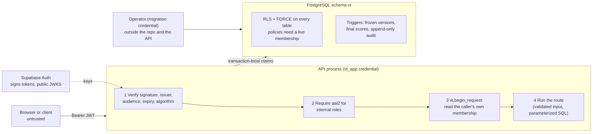

# Security Architecture

The security design on one page. It summarizes and links; the authoritative detail is in
[trust-boundary.md](trust-boundary.md) (mechanisms, limits, test map) and
[security-controls.md](security-controls.md) (every control with its status). Attack scenarios and residual
risks are in [threat-model.md](threat-model.md).

## Design principles

1. **The database is the tenant boundary.** Row level security enforces organization and vendor isolation, so
   a query bug cannot leak across tenants. Queries carry no organization filter on purpose.
2. **Never trust the client for identity or scope.** Only the signed token's `sub`, `email` and `aal` are
   used. Organization, role and vendor scope come from the user's membership row in the database.
3. **Least privilege, with separate roles for separate jobs.** The API cannot change schema, policies or the
   audit log, and the powerful credential is never in the API's environment.
4. **Fail closed.** No context, a malformed claim, an unknown algorithm or a missing `aal2` all end in denial.
5. **Say what is not covered.** Every limit is written down next to the control.

## Trust zones and the request path

## Authentication and MFA

- Supabase Auth authenticates; VendorTrust never stores passwords. Tokens are verified against the public
  JWKS (`app/auth.py`): ES256 and RS256 only, `iss`, `aud`, `exp` and a UUID `sub` required.
- Internal roles (`org_admin`, `analyst`, `reviewer`, `auditor`) need an `aal2` token on every data route
  (`app/deps.py`); anything other than exactly `aal2` counts as `aal1`. `vendor_user` is exempt. MFA
  enforcement cannot be disabled, and plain-http auth URLs are refused, when `VT_ENVIRONMENT=production`.
- The web app enrolls and challenges TOTP through Supabase's REST endpoints and shows an access gate over
  `GET /me` ([frontend.md](frontend.md)).

## Authorization

- `GET /me` provisions only the caller's own user row. Access needs a membership, granted by an administrator
  (first organization: an operator CLI that the database permits once, migration 0006).
- A request resolves the caller's memberships from the database. `X-Org-Id` can only select among them.
- The API checks the role for each action; RLS enforces the organization and vendor boundary and a coarse
  read/write class underneath it.

## Database roles

| Role | Purpose | Cannot |
|---|---|---|
| `vt_app` | The API's connection | Own objects, bypass RLS, run DDL or `TRUNCATE`, update or delete audit rows, `SET ROLE` |
| `vt_migrator` | Owns the objects, runs migrations and the one-time bootstrap | Is not used by the application, and cannot create a second organization once the one-time bootstrap window has closed |
| Administrative role | Creates the roles, trust root | Lives in neither the API nor CI environments |
| `anon`, `authenticated` (Supabase Data API) | None | Reach schema `vt` at all |

One `SECURITY DEFINER` function exists (`vt.claim_matches_active_membership()`): no arguments, no dynamic SQL,
pinned `search_path`, `EXECUTE` revoked from `PUBLIC`, owner without `BYPASSRLS`, source hash pinned by a test.

## Data integrity and audit

Published questionnaire versions and scored assessments are immutable (triggers). The audit log is append-only
for `vt_app` and records the acting user and role. It is not tamper-evident: an owner or superuser can rewrite
it, and there is no hash chain yet.

## Secrets

Database credentials live outside the repository in owner-only files read by a strict loader that never
prints a value; `Settings` holds no URL; the web config refuses a secret or service-role key; real env files
are git-ignored. The Claude Code credential guard (hook, deny rules, sandbox) is a local-only convenience, off
until registered, and is a tripwire rather than a sandbox ([CLAUDE.md](../CLAUDE.md)).

## Delivery pipeline

| Gate | Where | What it does |
|---|---|---|
| API CI | `.github/workflows/ci-api.yml` | `ruff`, `mypy` (strict), `pytest` against a throwaway PostgreSQL 17 service; database tests **fail** rather than skip in CI |
| Web CI | `.github/workflows/ci-web.yml` | ESLint, `tsc`, Vitest, `next build` |
| Security | `.github/workflows/security.yml` | gitleaks over history, `pip-audit` of the locked production dependencies, `pnpm audit --prod`, weekly |
| Hygiene | all workflows | Actions pinned to commit SHAs, read-only token permissions, no persisted credentials, `pull_request` (not `pull_request_target`) |

Not yet in place: Content Security Policy, rate limiting, a hash-chained audit log, Dependabot, a branch
protection rule requiring these checks (a repository setting).
